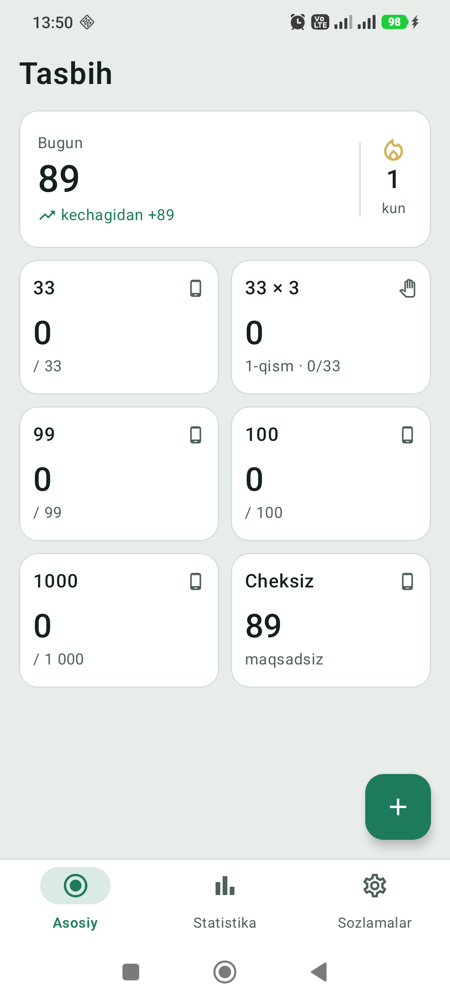
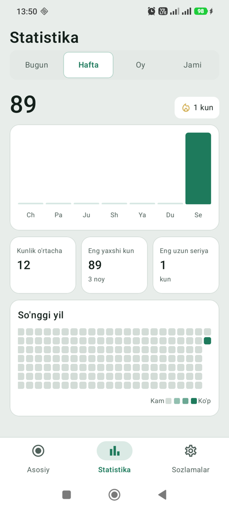

# Tasbih

Android uchun tasbih sanagich. Ekranga bosib, **Volume** va **Power** tugmalari bilan sanaydi — telefon cho'ntakda, ekran o'chiq bo'lsa ham. Internetga ulanmaydi, reklama va kuzatuv yo'q.

> Shaxsiy foydalanish uchun, Play Market'da yo'q — APK [Releases](../../releases) bo'limidan o'rnatiladi.

<p>
  
  
</p>

## Imkoniyatlar

**Sanash**
- Ikki rejim: **Qurilma tugmalari** (Volume Up/Down, Power — har biri +1) va **Oddiy tasbih** (ekranga bosish, donalar bilan).
- Shablonlar: 33, 33 × 3, 99, 100, 1000, Cheksiz — va o'zingizniki. Son sessiyalar orasida saqlanadi.
- Maqsadga yetganda vibratsiya/ovoz, oraliq signal (masalan har 33 da). Telefon jim bo'lsa — faqat vibratsiya.

**Himoya va chekka holatlar**
- Sanash paytida ekran qulfi (tasodifiy bosishdan), ilovani mahkamlash (screen pinning), cho'ntak rejimi (proximity).
- Qo'ng'iroq yoki budilnik kelganda — avtomatik pauza.
- Ilovadan chiqilsa (Home) — avtomatik pauza; ekran o'chishi esa sessiyani to'xtatmaydi.
- Tez ketma-ket va bir vaqtda bosishlar filtrlanadi.

**Statistika va odatlar**
- Bugun / Hafta / Oy / Jami grafiklari, shablonlar va sessiyalar bo'yicha.
- Kunlik o'rtacha, eng yaxshi kun, eng uzun seriya, so'nggi yil kalendari.
- Kunlik maqsad va belgilangan vaqtda eslatma.

**Qulayliklar**
- Bosh ekran vidjeti (bugungi son, ▶ — tez boshlash) va Quick Settings tugmasi.
- Zaxira: JSON faylga eksport, import (birlashtirish yoki almashtirish).
- O'zbekcha va English; qorong'i, yorug' va tizim mavzusi; 4 xil accent rang.

## Boshqaruv

| Amal | Qanday |
|---|---|
| Sanash | Volume Up, Volume Down yoki Power — har biri +1 |
| Pauza / davom | Vol Up + Down birga qisqa bosish |
| Tugatish | Vol Up + Down 3 s ushlab turish (1.5 s da ogohlantiradi) |
| Himoyani ochish | Ekrandagi qulfni 2 s bosib turish |

> Power tugmasi ekranni o'chiradi/yoqadi — har o'tish +1 sanaladi.

## O'rnatish

1. [Releases](../../releases) dan oxirgi `tasbih-vX.Y.Z.apk` ni yuklab oling.
2. Telefonda "Noma'lum manbalardan o'rnatish"ga ruxsat bering va APK ni oching.
3. Birinchi ochilishda ruxsatlarni bering:
   - **Maxsus imkoniyatlar (Accessibility) → Tasbih** — Volume tugmalari bilan sanash uchun (tugmalar faqat sessiya faol bo'lganda ushlanadi);
   - bildirishnomalar, telefon holati (qo'ng'iroqda pauza), batareya optimizatsiyasidan chiqarish.
4. **HyperOS / MIUI** — qo'lda o'chirish tavsiya etiladi (ilova ichida ro'yxat bor):
   Power 2× — kamera, Vol Down 2× — Quick snap, Vol Up + Down accessibility shortcut, bildirishnomada ekran yonishi.
   Ilovani mahkamlash (Screen pinning) — yoqilgan bo'lsin.

Talab: Android 12+ (minSdk 31). Redmi Note 14 (HyperOS) da sinalgan.

## Manbadan yig'ish

JDK 17 va Android SDK kerak (`local.properties` da `sdk.dir`).

```bash
./gradlew :app:testDebugUnitTest     # unit testlar
./gradlew :app:assembleDebug         # debug APK
./gradlew :app:assembleRelease       # release APK
adb install -r app/build/outputs/apk/debug/app-debug.apk
```

**Texnologiyalar:** Kotlin 2.1, Jetpack Compose (Material 3), Room, DataStore, kotlinx.serialization, AccessibilityService, AlarmManager, AppWidget, TileService.

```
app/src/main/java/uz/asrorqobulov/tasbih/
├── engine/     tugma bosishlarini talqin qilish, Power filtri, signallar (testlangan)
├── session/    sessiya holat mashinasi, vibratsiya, qo'ng'iroq/budilnik, bildirishnoma
├── data/       Room (shablonlar, sessiyalar), sozlamalar, statistika, zaxira
├── service/    Accessibility servisi, Quick Settings tugmasi
├── reminder/   kunlik eslatma
├── widget/     bosh ekran vidjeti
└── ui/         Compose oynalari
```

## Reja

To'liq reja va dizayn qarorlari — [PLAN.md](PLAN.md), HTML mockup — [mockup/index.html](mockup/index.html).

Keyingi katta bosqich — **zikr jumlalari** (2-release): faqat tasdiqlangan manbadan, lotin va kirill yozuvida, ketma-ket zikrlar zanjiri bilan.

## Maxfiylik

Ilovada `INTERNET` ruxsati yo'q — barcha ma'lumot faqat telefonda saqlanadi. Accessibility servisi faqat Volume tugmalari va bildirishnoma hodisalarini, faqat sanash sessiyasi faol bo'lganda ishlatadi.

---

<details>
<summary>English</summary>

**Tasbih** is a personal Android prayer-bead counter. Count with screen taps, the volume buttons and the power button — even in a pocket with the screen off. It has touch-lock and pocket protection, auto-pause on calls and alarms, statistics (charts, streaks, yearly heatmap), a daily goal with reminder, a home screen widget, a Quick Settings tile and JSON backup. Uzbek and English UI. No internet permission.

Install the APK from [Releases](../../releases) (Android 12+), then enable the accessibility service (Settings → Accessibility → Tasbih) to count with the device buttons. Build from source with JDK 17: `./gradlew :app:assembleDebug`.

</details>
